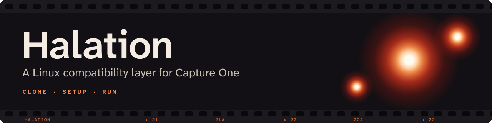
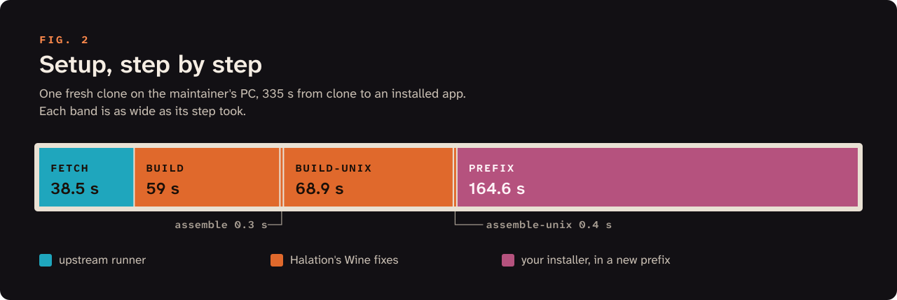
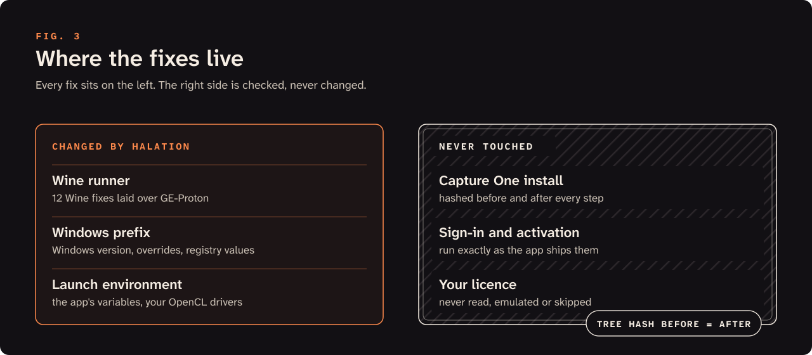
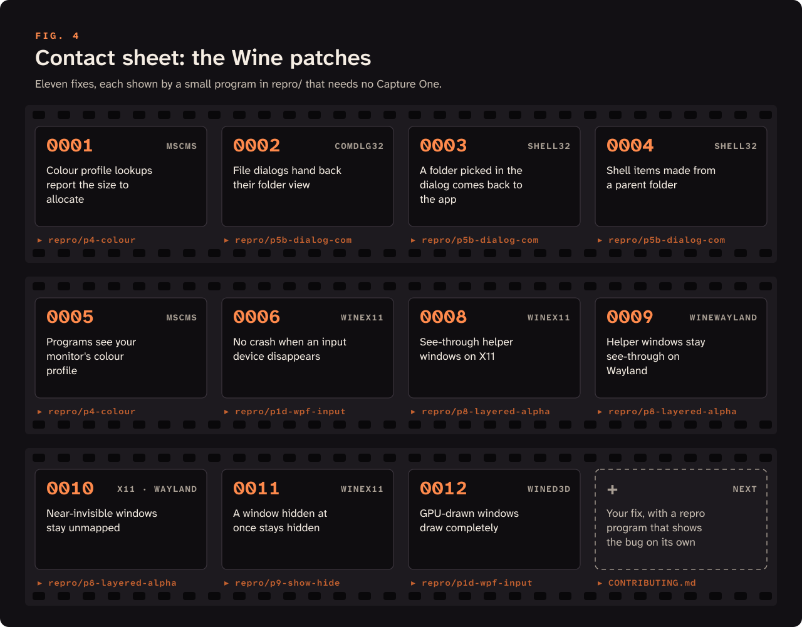
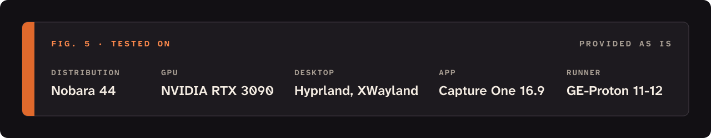

<!-- rumdl-disable MD041 -->


# Run Capture One on Linux

**[Install](#install-step-by-step)** · **[How it works](#how-it-works)** · **[Ground rules](#ground-rules)** · **[Status](#status)** · **[Contributing](#contributing)** · **[Reference](docs/reference.md)**

Halation runs the Windows edition of Capture One on a Linux desktop, through Proton and Wine. You bring the installer you downloaded; `setup` builds a pinned GE-Proton runner with a small set of Wine fixes, creates a Windows prefix and installs the app into it, and `run` starts it.

The app itself is never modified, and every Wine fix comes with a small program that shows the bug without Capture One.

- **Your install stays untouched.** Setup and every launch hash the install folder before and after. A changed file fails the run, except when the app's own program has a higher version, as after an update.
- **Exports match Windows.** Three RAW files exported to TIFF on the CPU were pixel-identical to the same machine's Windows install: 0 differing pixels.
- **Fixes, not workarounds.** Eleven Wine patches fix what the app trips over: colour profiles, file dialogs, input devices, helper windows and GPU-drawn windows. Each one has a repro program in `repro/`.
- **Pinned and checked.** Setup downloads one pinned GE-Proton release, checks its published SHA-512 and refuses anything that does not match.
- **Open to build on.** The generic parts live in `core/`, so the same layer can carry other Windows apps through their own profile.

```console
$ ./setup "Capture One installer.exe"
fetch: complete (38.5s)
build: complete (59.0s)
assemble: complete (0.3s)
build-unix: complete (68.9s)
assemble-unix: complete (0.4s)
prefix: complete (164.6s)
$ ./run
```

**Early, unreleased, provided as is.** It has been tested on one machine so far, and reports from other distributions and GPUs are the most useful help right now.

> [!NOTE]
> Halation is an independent project, not affiliated with Capture One A/S, Phase One or Fujifilm. You need your own licensed copy of Capture One; see [Legal](#legal).

## Contents

- [Install, step by step](#install-step-by-step)
- [How it works](#how-it-works)
- [Ground rules](#ground-rules)
- [Wine patches](#wine-patches)
- [Status](#status)
- [Questions](#questions)
- [Contributing](#contributing)
- [Layout](#layout)
- [Legal](#legal)

## Install, step by step

**In short**, for anyone used to building from source:

```sh
git clone https://github.com/ProtonCats/Project-Halation-For-Capture-One.git halation
cd halation
./setup "<path to the Capture One installer>"
./run
```

The steps below say the same thing with every command spelled out.

### 1. Check your computer

- **Linux on a 64-bit PC** (x86-64) with a graphics driver that supports Vulkan. Halation has been tested with an NVIDIA card; AMD and Intel are untested.
- **About 10 GB of free space** in your home folder, for the runner, its build files and the Windows prefix with Capture One in it.
- **The Capture One installer for Windows** (the `.exe` file), downloaded from the official Capture One website, and your Capture One account.

### 2. Install the tools Halation builds with

Open a terminal and run the command for your distribution. Only Fedora-based systems have been tested so far.

**Fedora and Nobara:**

```sh
sudo dnf install git-core curl autoconf perl-interpreter bison flex make gcc clang lld llvm binutils patch \
  pkgconf-pkg-config python3 libX11-devel libXi-devel libXext-devel libXrandr-devel libXrender-devel \
  libXfixes-devel libXcursor-devel libXcomposite-devel libXinerama-devel vulkan-loader-devel wayland-devel \
  libxkbcommon-devel ocl-icd-devel freetype-devel fontconfig-devel dbus-devel libglvnd-devel glibc-devel
```

Nobara already includes `umu-launcher`. On Fedora, install the `.rpm` for your release from the [umu-launcher releases](https://github.com/Open-Wine-Components/umu-launcher/releases).

**Debian 13 and Ubuntu 24.04 (untested):**

```sh
sudo apt install git curl autoconf perl bison flex make gcc clang lld llvm binutils patch pkg-config python3 \
  libx11-dev libxi-dev libxext-dev libxrandr-dev libxrender-dev libxfixes-dev libxcursor-dev libxcomposite-dev \
  libxinerama-dev libvulkan-dev libwayland-dev libxkbcommon-dev libxkbregistry-dev ocl-icd-opencl-dev \
  libfreetype-dev libfontconfig-dev libdbus-1-dev libegl-dev libc6-dev
```

Then install `umu-launcher` from the `.deb` packages on its [releases page](https://github.com/Open-Wine-Components/umu-launcher/releases).

**Arch (untested):**

```sh
sudo pacman -S --needed git curl autoconf perl bison flex make gcc clang lld llvm binutils patch pkgconf python \
  umu-launcher libx11 libxi libxext libxrandr libxrender libxfixes libxcursor libxcomposite libxinerama \
  vulkan-icd-loader vulkan-headers wayland libxkbcommon ocl-icd opencl-headers freetype2 fontconfig dbus libglvnd
```

For GPU image processing, your graphics driver's OpenCL support must be installed too; it is often a separate package. Without it, Capture One processes images on the CPU.

### 3. Download Halation

```sh
git clone https://github.com/ProtonCats/Project-Halation-For-Capture-One.git halation
cd halation
```

### 4. Run setup

Give setup the path to the installer you downloaded, for example:

```sh
./setup ~/Downloads/<the Capture One installer>.exe
```

Setup takes about six minutes and prints one line per step, ending with `prefix: complete`. It runs the Capture One installer silently, so no installer window appears. Running setup again is safe: finished steps are checked and skipped.



### 5. Start Capture One

```sh
./run
```

Sign in as you would on Windows. In the app's file dialogs your Linux files are on drive `Z:`, so your home folder is `Z:\home\<your user name>`.

### 6. Optional: add it to your app menu

Save this as `~/.local/share/applications/halation.desktop`, with the real path to your `halation` folder:

```ini
[Desktop Entry]
Type=Application
Name=Capture One (Halation)
Exec=/home/<your user name>/halation/run
Icon=camera-photo
Categories=Graphics;Photography;
```

### Updating

```sh
cd halation
git pull
./setup ~/Downloads/<the Capture One installer>.exe
```

Setup checks every finished step. When an update of Halation changes a patch or the GE-Proton release, setup builds the new runner beside the one you have and switches over at the end; close Capture One for that. If the build fails, the old runner stays in use.

**When Halation's profile changes**, close Capture One first. Setup applies the difference to the prefix you have: the installer does not run again and the app's files are not touched.

**When Capture One updates itself**, let the update finish and close the app, then run `./setup`. It recognises an update by the program's higher version and records the new files. This has been tested with stand-in programs, not yet with a real Capture One update.

**Keep `pfx`.** It holds your installed Capture One, its settings and its activation. Setup never names a finished prefix for removal. When it cannot accept one, it leaves it as it is and says why.

### Removing

Everything Halation made is in `~/.local/share/halation-layer`, plus the `halation` folder you cloned; delete both to remove it. Catalogs and sessions you saved inside the prefix (under `pfx/drive_c/users/steamuser`) go with it, so copy them out first.

### If something goes wrong

- **`missing required tools: ...`**: install the tools it names (step 2), then run setup again.
- **`... remove <folder> before retrying`**: a folder no longer matches what setup built in it. Delete that folder, then run setup again. Never delete a finished prefix (`pfx`) for this.
- **`... was left as it is: ...`**: keep the folder. The text after the colon is the reason, for example that the app is open or an update is not finished. If the app no longer starts, open an issue before removing anything.
- **`a local installer file is required`**: the path after `./setup` must point to the installer `.exe`.
- **"Open With plugin could not be enabled"** in Capture One: that plugin needs Microsoft's .NET Framework 4.8; see the [reference](docs/reference.md#optional-the-plugin-runtime).
- **Anything else**: open an issue with the output of `./setup`; see [Contributing](#contributing).

## How it works


- **`setup`** fetches the pinned GE-Proton release, rebuilds only the Wine libraries that `patches/` changes, and lays them over the runner. It then creates one Windows prefix, applies the app's profile (Windows version, library overrides, a few registry values) and runs your installer silently.
- **`run`** starts the app through `umu-run` with the profile's environment, passes the host's OpenCL drivers in, and checks the install folder before and after.
- **Everything else is upstream:** Wine, DXVK and vkd3d-proton come with GE-Proton; Halation pins a release and changes only what its patches name.

The [reference](docs/reference.md) covers each step in detail: the runner build, profiles, the prefix, the display colour profile and the optional .NET Framework runtime for the app's plugins.

## Ground rules



| | Rule | What it means | Enforced by |
|---|---|---|---|
| 1 | **The install folder is never modified** | Fixes live in the runner, the prefix or the launch environment, never in the app's files. | A hash of the install tree before and after every setup step and launch (`core/treehash.py`). A change fails it, except the app's own update during a launch, known by a higher program version. |
| 2 | **Licensing is never touched** | Sign-in, trial, activation and machine checks run exactly as shipped. No code reads, emulates, skips or patches them. | Profile entries that touch authentication or licensing are refused (`core/setup.py`). |
| 3 | **You bring the software** | Setup installs the copy you downloaded. Halation never downloads, mirrors or links it. | `./setup` takes a local installer and nothing else. |
| 4 | **Every fix stands on its own** | Each Wine fix ships with a small Windows program that shows the bug without Capture One, so anyone can check it and report it to Wine. | `repro/`, one program per behaviour. |
| 5 | **Nothing private leaves** | Logs, traces and machine details stay on the machine that made them. | Every push runs a leak check over each commit, message, path and ref (`tools/prepush.py`). |

## Wine patches



| Patch | What it fixes | Shown by |
|---|---|---|
| `0001` mscms | `GetStandardColorSpaceProfileW` reports the size a caller must allocate | `repro/p4-colour` |
| `0002` comdlg32 | The file dialog returns its folder view through `QueryService` | `repro/p5b-dialog-com` |
| `0003` shell32 | `IFolderView2::GetSelection`, so a picked folder comes back to the app | `repro/p5b-dialog-com` |
| `0004` shell32 | `SHCreateItemWithParent` | `repro/p5b-dialog-com` |
| `0005` mscms | The WCS default display profile lookups, so programs see the monitor's colour profile | `repro/p4-colour` |
| `0006` winex11 | No crash when an input device disappears while Wine reads its button map | `repro/p1d-wpf-input` (device churn) |
| `0007` winex11 | An OpenGL child of a layered window no longer ends the program, and is drawn with the window's alpha | `repro/p10-layered-child` |
| `0008` winex11 | Constant layered alpha applied in the window surface, so helper windows are see-through on X11 | `repro/p8-layered-alpha` |
| `0009` winewayland | The layered alpha survives a change of surface role on Wayland | `repro/p8-layered-alpha` |
| `0010` winex11, winewayland | Near-invisible layered windows (constant alpha below 8) stay unmapped, so they take no pointer input and draw no blurred band | `repro/p8-layered-alpha` |
| `0011` winex11 | A window hidden right after it is shown stays hidden (backport of Wine `2b05f63811`) | `repro/p9-show-hide` |
| `0012` wined3d | Partial copy presents are shown as full frames, so GPU-drawn windows draw completely | `repro/p1d-wpf-input` (`--autotype`) |

Patches are LGPL-2.1-or-later, as Wine is. Each one's test program is ready for a WineHQ bug report.

## Status

**Early, unreleased, provided as is.** Tested on one machine; other setups are untested.



**Known issues:**

- File dialogs are Wine's own, not your desktop's.
- Edits show more slowly than on Windows: 250 to 395 ms from a slider change to the preview.
- True fullscreen can flicker (seen with adaptive sync on).

## Questions

### Is there a Linux version of Capture One?

Not a native one: Capture One's desktop editions are for Windows and macOS. Halation runs the Windows edition on Linux through Proton and Wine, with no virtual machine and no Windows installation.

### Do I need a licence?

Yes, your own licensed copy of Capture One. Halation installs the copy you downloaded and leaves sign-in and activation to the app.

### Why not plain Wine?

Capture One trips over several Wine bugs: colour profile lookups, file dialogs, helper windows and input devices. Halation pins a GE-Proton release, adds fixes for those bugs, and sets up the prefix the way the app needs it.

### Which distributions and desktops work?

Tested so far on Nobara 44 (Fedora-based) with an NVIDIA GPU, on Hyprland through XWayland. Other x86-64 distributions with a Vulkan driver, and desktops such as KDE Plasma and GNOME, are untested; a report from yours helps.

## Contributing

Halation is meant to be built on. Branches, fixes, profiles for other apps and plain test reports are all welcome; [CONTRIBUTING.md](CONTRIBUTING.md) says how, and every commit carries a DCO sign-off. Everyone follows the [Code of Conduct](.github/CODE_OF_CONDUCT.md).

- **Test it on your machine.** A run on another distribution, desktop or GPU is the most useful report right now.
- **Fix a Wine bug.** Add the patch with a repro program that shows the bug on its own, and a test.
- **Bring another app.** `core/` is generic; a new app needs only its own profile.

## Layout

```text
core/       setup, launch and runner pieces any Windows app can use
profiles/   what is specific to one app (captureone/)
patches/    Wine patches (LGPL-2.1-or-later)
repro/      small Windows programs that show a Wine behaviour on their own
tests/      tests for everything above (python3 -m unittest discover -s tests)
tools/      the leak check and push helpers
docs/       the reference and the images on this page
LICENSES/   licence texts
```

## Legal

**Disclaimer.**

- **Independent.** Halation is a user-made project. It is not affiliated with, endorsed by or sponsored by Capture One A/S, Phase One or Fujifilm.
- **Your own licensed copy.** You need your own licensed copy of Capture One. Halation never downloads, mirrors or links the software, and never touches sign-in, trial or activation.
- **No Capture One code.** The repository contains no installer, library, model, profile or decompiled text from Capture One.
- **Why it exists.** So licensed customers on Linux can run the copy they paid for (interoperability).

**Licence.** Own code is MIT; Wine patches are LGPL-2.1-or-later, as Wine is; the Code of Conduct is CC BY 4.0. Each file carries an SPDX header, and `REUSE.toml` covers the rest.

**Trademarks.** Capture One is a trademark of its owner, used here only to say what Halation runs. Halation's name and logo carry no Capture One, Phase One or Fujifilm marks; the repository name uses "Capture One" only to say what Halation is for.
